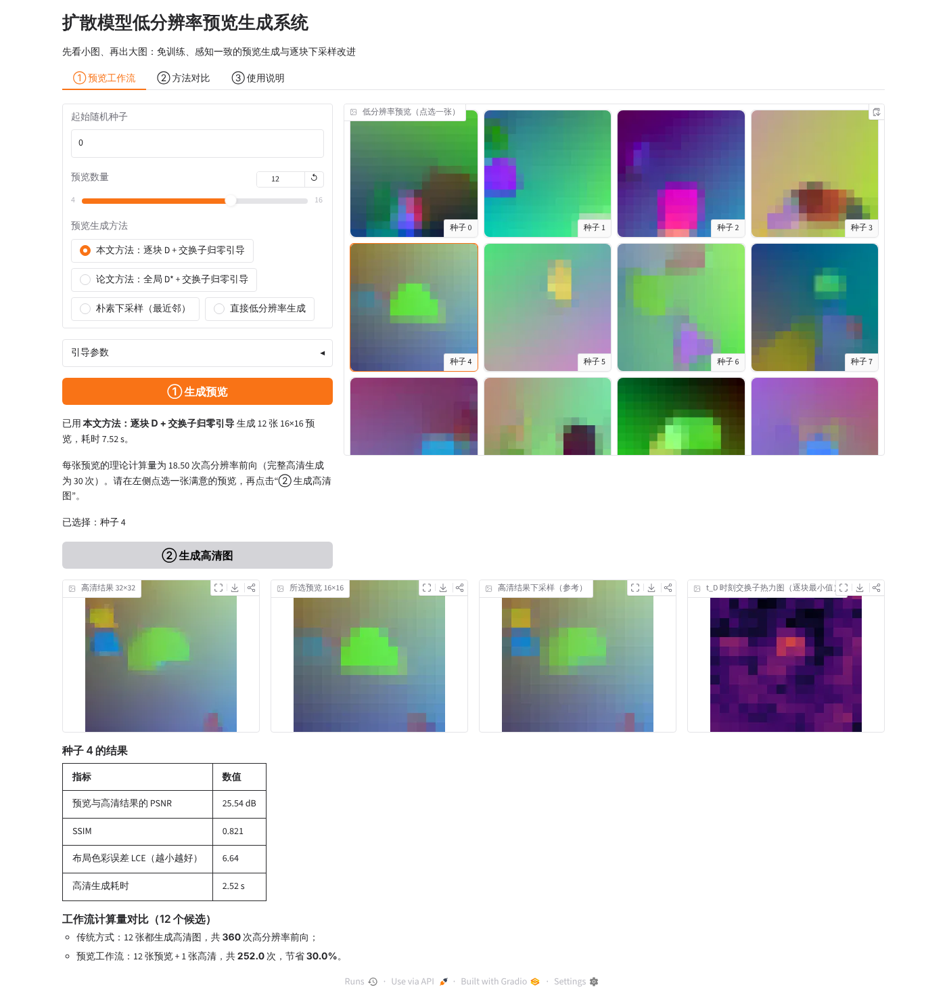
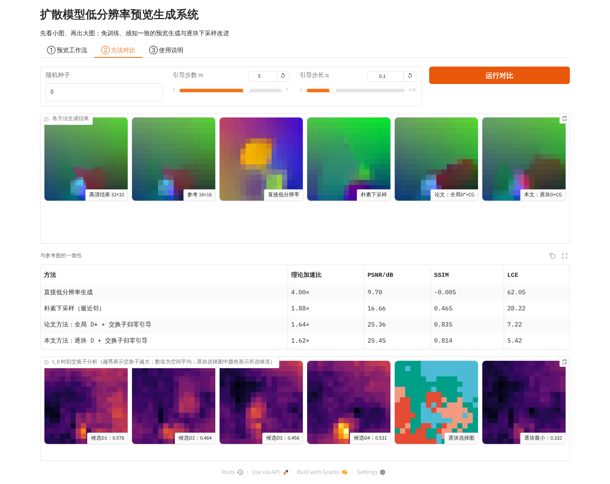

# 扩散模型低分辨率预览生成：原型代码

本代码是课程论文《扩散模型低分辨率预览生成的交换子分析与逐块下采样改进》的配套原型系统。

**主程序是一个网页版的图像生成系统 `app.py`**，流程如下：
1. 一次生成多张低分辨率预览；
2. 用鼠标点选满意的一张；
3. 系统只对它生成高分辨率图像；
4. 同时显示预览与高清结果的一致性指标、交换子热力图，以及节省的计算量。



它用 JAX 从零实现了以下内容：
- 一个整流流（rectified flow）图像生成模型；
- CVPR 2026 论文 *Training-free, Perceptually Consistent Low-Resolution Previews with High-Resolution Image for Efficient Workflows of Diffusion Models* 中的预览生成算法（全局下采样矩阵选择 + 交换子归零引导）；
- 全部对比方法；
- 本文提出的**逐块交换子最小化下采样（BCD）**。

报告第 3 节的所有数值都由本代码运行得到。

## 1. 运行环境

- Python 3.10 及以上（开发时使用 3.13）
- 只需 CPU，不需要 GPU；开发环境为 2 核 CPU、8 GB 内存
- 安装依赖：

```bash
pip install -r requirements.txt
```

## 2. 文件说明

| 文件 | 作用 | 对应报告章节 |
|---|---|---|
| `app.py` | **原型系统主程序**（Gradio 网页界面）：预览工作流、方法对比、使用说明三个页面 | 3.8 |
| `data.py` | 合成图像数据集（渐变背景 + 随机几何体），面积平均下采样；直接运行可导出样例素材 | 3.1 |
| `model.py` | 全卷积 U-Net 速度场网络 $v_\theta(x,t)$，可在 32×32 和 16×16 上运行 | 3.1 |
| `train.py` | 用整流流损失在两种分辨率上联合训练 | 3.1 |
| `preview.py` | **核心算法**：朴素/面积平均/随机/argmax 下采样、论文的全局 D* 选择、本文的逐块 D 选择、交换子归零引导 | 2.4–2.6 |
| `experiments.py` | 全部实验：交换子分析、超参数、主对比、消融、引导机理分析、配对检验 | 3.2–3.6 |
| `plots.py` | 根据实验结果绘制报告中的图 | 3.2–3.4 |
| `demo.py` | 快速演示：生成一张各方法的对比图 | — |
| `ckpt.pkl` | **训练好的模型参数**（可直接使用，免去约 1 小时的训练） | — |
| `assets/samples/` | 数据集样例图像（32×32 高分辨率与 16×16 低分辨率各 16 张） | 3.1 |
| `assets/screens/` | 系统界面截图 | 3.8 |
| `results/` | 实验结果：`results.json`（全部数值）、`samples.npz`、报告用图 `fig_*.png` | 3 |

## 3. 使用方法

所有命令都在本目录下执行。

### 3.0 启动原型系统（推荐）

```bash
python app.py
```

启动后在浏览器打开 http://127.0.0.1:7860 。首次点击按钮时程序需要编译，约 5～10 秒；之后每次操作 1～3 秒。

- **① 预览工作流**
  1. 设置起始种子、预览数量和预览方法；
  2. 点“① 生成预览”；
  3. 在右侧点选一张预览；
  4. 点“② 生成高清图”，查看高清结果、一致性指标、交换子热力图和计算量对比。
- **② 方法对比**：输入一个种子并点“运行对比”。页面会并排显示直接低分辨率、朴素下采样、论文方法和本文方法的结果与指标，以及 4 个候选下采样矩阵的交换子图和本文的逐块选择图。


- **③ 使用说明**：系统原理简介。

### 3.1 命令行快速演示（约 10 秒）

```bash
python demo.py --seeds 0 1 2 3 4 5 --out demo.png
```

生成的 `demo.png` 中，每一列是一个随机种子，各行依次为：
1. 高分辨率结果
2. 参考图
3. 直接低分辨率生成
4. 朴素下采样
5. 论文方法
6. 本文方法

### 3.2 复现全部实验（2 核 CPU 约 15～20 分钟）

```bash
python experiments.py --ckpt ckpt.pkl --out results    # 加 --quick 可用少量样本在约 2 分钟内跑通
python plots.py results                                # 生成 fig_qual.png / fig_analysis.png / fig_speed.png
```

### 3.3 重新训练模型（可选，2 核 CPU 约 55 分钟）

```bash
python train.py --steps 9000 --out ckpt.pkl
```

### 3.4 重新导出样例素材（可选）

```bash
python data.py      # 写入 assets/samples/
```

## 4. 主要参数

| 参数 | 位置 | 含义 | 默认值 |
|---|---|---|---|
| `N` | `preview.preview` | 总采样步数 | 30 |
| `D` | `preview.preview` | 在第 D 步下采样（$t_D=D/N$） | 10 |
| `select` | `preview.preview` | 下采样方式：`nearest` / `avgpool` / `random` / `argmax` / `global`（论文）/ `block`（本文） | `global` |
| `cg`, `m`, `alpha` | `preview.preview` | 是否使用交换子归零引导、引导步数、步长 | 关闭 / 5 / 0.1 |

## 5. 说明

- 数据集由程序随机生成，不需要下载任何外部数据。`assets/samples/` 中的图片仅用于展示数据的样子。
- 计算量以“高分辨率前向次数”计，一次低分辨率前向按 1/4 计；实际耗时在 `results.json` 的 `sec_per_img` 字段中给出。
- 随机种子固定，重复运行会得到相同的结果；不同 CPU 或库版本之间可能有极小的浮点差异。

## 6. 附带的日志

- `train.log`：训练过程的损失曲线（9000 步，最终损失约 0.130）。
- `exp.log`：`experiments.py` 完整运行的输出（报告第 3 节的数值来源）。
